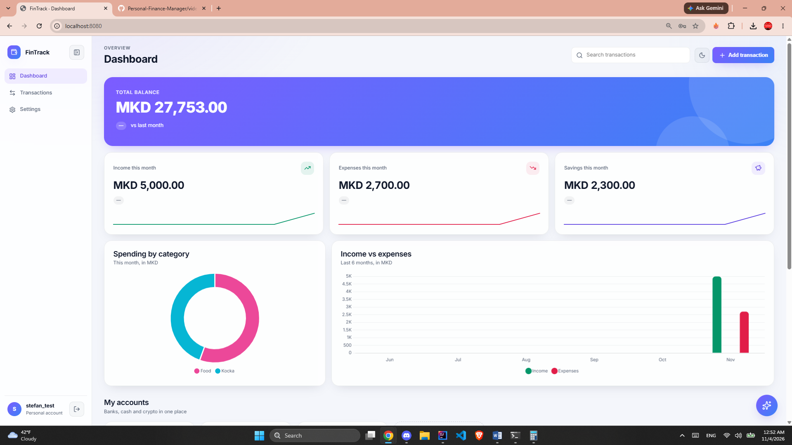

# Personal Finance Manager

Web application for tracking personal finances: bank, cash and crypto accounts, income and expenses, and a total balance across everything.

## Features
- Dashboard with total balance and all accounts
- Add accounts (bank, cash, crypto) and transactions (income or expense)
- Transactions list
- Light and dark theme
- English and Macedonian language
- Mobile layout with bottom navigation

## Tech stack
- Backend: Java, Spring Boot, Spring Web, Spring Data JPA, Validation
- Database: PostgreSQL
- Frontend: HTML, CSS, JavaScript
- Build: Maven

## How to run
1. Install JDK 17+ and PostgreSQL.
2. Create a database and set the connection details in `src/main/resources/application.properties`.
3. Run `./mvnw spring-boot:run`
4. Open http://localhost:8080

## AI: Ask about your spending
Ask a question in plain language, such as "How much did I spend on food?" or "What was my biggest expense?". The backend loads your transactions, calculates the totals in Java, and asks a local model running in [Ollama](https://ollama.com) to answer using only that data.

- Ollama must be running on this machine (default: http://localhost:11434).
- Pull the model once: `ollama pull qwen2.5-coder:3b`
- Model and URL are set in `src/main/resources/application.properties` (`ollama.model`, `ollama.base-url`). The read timeout (`ollama.read-timeout`, default 120s) is generous because the model runs on CPU.
- Endpoint: `POST /api/ask` with body `{"question": "..."}` (requires login). Response: `{"answer": "..."}`.
- If Ollama is not running, the answer is "The AI model is not running" instead of an error.
